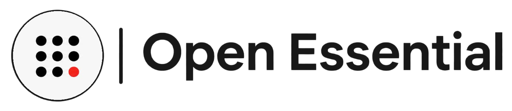
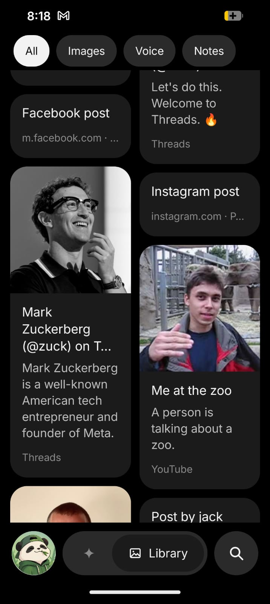
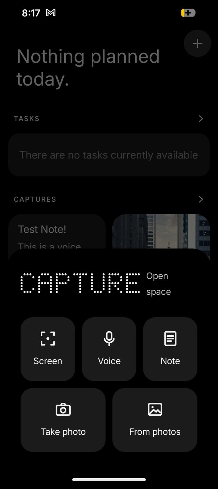
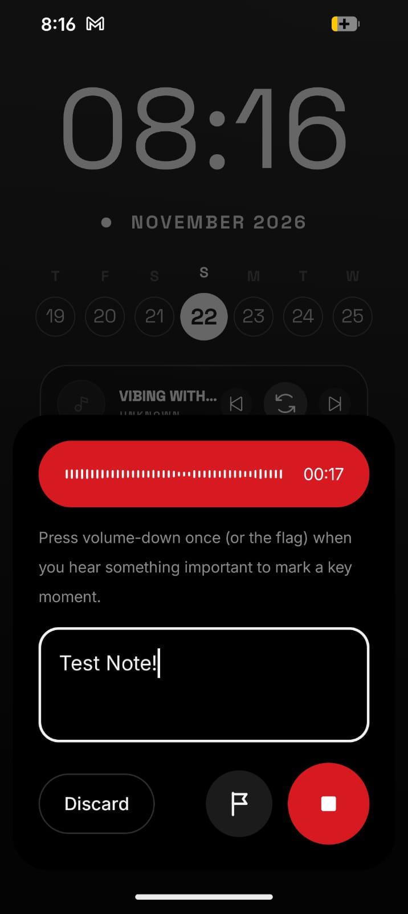
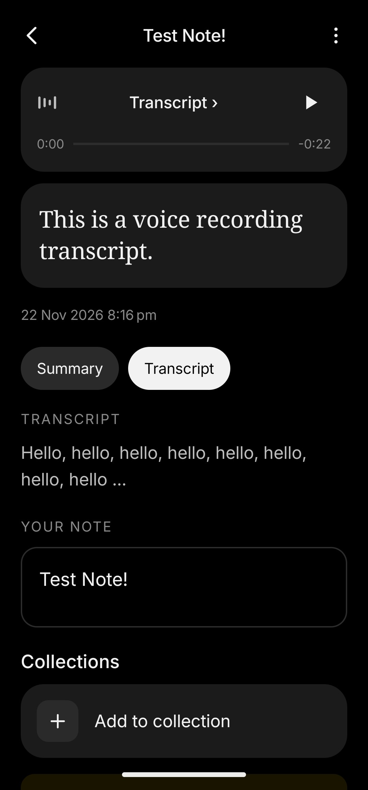

<p align="center">
  <picture>
  <source media="(prefers-color-scheme: dark)" srcset="assets/header-dark.png">
  
</picture><br>
  
  
  
  
</p>

# Open Essential

An open-source, local-first alternative to Nothing's Essential Space for Android. Capture voice notes, screenshots, documents and links, then turn them into a searchable personal space with on-device AI.

**Kotlin · Jetpack Compose · On-device text, vision and speech · MIT**

## Capture now. Find it later.

- **One library for what matters.** Save images, recordings, notes, PDFs, Office documents and shared web links. Organize captures into collections.
- **AI that runs on your phone.** Generate summaries, transcripts, tags and suggested tasks with downloadable local models. No AI account or API key required.
- **Capture without a dedicated key.** Use volume-button shortcuts, Android's assistant shortcut, a Quick Settings tile or the share sheet.
- **Recall with context.** Search saved content, explore related captures and ask questions about your library.
- **Keep control.** Review suggested tasks and events before adding them. Export captures, restore items from Trash or delete them.

## In the app

<p align="center">
  
  
  
  
</p>

## Get started

1. Install **OpenEssential-release.apk** from this repository's **Releases** page.
2. Open **Settings → On-device AI** and download or import the model pack, approximately **928 MB**. Downloads use Wi-Fi by default and verify each file's size and SHA-256.
3. Run **Check the engine**, then choose the capture shortcuts you want to enable.

Android 8.0+ is required. On-device AI needs a compatible 64-bit ARM processor with dot-product and FP16 support; whole-screen capture requires Android 11+. The current analysis pipeline uses English. Shortcut availability depends on your phone's Android settings.

See [Installation and device setup](docs/INSTALL.md) for permissions, model setup and supported document formats.

## Local by design

Text, image and speech inference run on the device through **llama.cpp / libmtmd** and **whisper.cpp**. Captures and AI results are stored in the app's private storage; app backups and device transfer are disabled.

Network access is used for model downloads and, if you enable them, public web-link previews. Preview requests contact the linked website and may contact its media or preview providers. Sharing or exporting content is your choice. See [Privacy](docs/PRIVACY.md).

## Build from source

Requires **JDK 17**, **Android SDK 35**, **NDK 28.2.13676358** and **CMake 3.22.1**.

```powershell
# Download and hash-check the pinned native engine sources.
powershell -ExecutionPolicy Bypass -File tools\fetch-engines.ps1

# Build a debug APK with the included Gradle wrapper.
.\gradlew.bat assembleDebug
```

The app uses Kotlin 2.1.0, Compose, Android Gradle Plugin 8.7.3 and PDFBox-Android. Native inference is CPU-based. See [Build guide](docs/BUILDING.md) for project structure and release signing.

## Credits and license

- **Qwen team**: Qwen3.5-0.8B text and vision model. **Unsloth**: GGUF conversion and quantization.
- **OpenAI**: Whisper speech model. **ggml contributors**: llama.cpp, libmtmd and whisper.cpp.
- **AndroidX / Jetpack Compose** and **PDFBox-Android**: application and document-processing libraries.

Application source is available under the [MIT License](LICENSE). Third-party code and model terms are recorded in [NOTICES](NOTICES) and [Model and engine credits](docs/CREDITS.md).

Open Essential is an independent project, not affiliated with or endorsed by Nothing Technology. Nothing and Essential Space are their respective owner's names.
